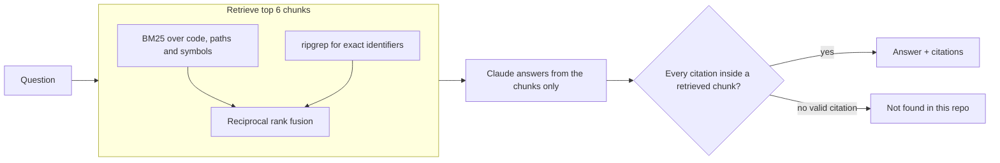

<div align="center">

# repo-ask

**Ask questions about any codebase. Get answers with `file:line` citations, or an honest "not found".**

[](https://github.com/iamsohungrynow/repo-ask/actions/workflows/tests.yml)

[](LICENSE)

</div>

```text
$ repo-ask ask "where does the runner fall back to keyword recall?" --repo ../soliton
engine/memory/runner.mjs:616-644
engine/memory/runner.mjs:187-199
  In `recallRunnerTaskMemory`, if the MemWal recall call fails or is unavailable, the catch block
  returns an empty array, and the function then merges results with `indexedProjectMemories`,
  which serves as the keyword/indexed fallback ...
```

`repo-ask` is a small command-line tool for finding your way around an unfamiliar repository. It
splits the code into function- and class-level chunks, retrieves the most relevant ones, and asks
Claude to answer **from those chunks only**. Every citation is then checked against what was
actually retrieved, so you never get a reference the tool did not read.

- **Cited answers.** Each answer starts with the `path:start-end` ranges that support it.
- **No guessing.** If the retrieved code does not answer the question, it prints
  `Not found in this repo`.
- **Works on any local checkout.** Nothing is uploaded except the handful of retrieved chunks sent
  to the Claude API, and the index lives outside your repo.
- **Small and hackable.** About 700 lines of Python, no vector database, no server.
- **Measurable.** A built-in `eval` command scores retrieval and answers against your own questions.

## Quickstart

You need Python 3.11+, an [Anthropic API key](https://console.anthropic.com/), and optionally
[ripgrep](https://github.com/BurntSushi/ripgrep) (`rg`) on your `PATH`.

```bash
pipx install git+https://github.com/iamsohungrynow/repo-ask   # or: pip install git+https://...
export ANTHROPIC_API_KEY=sk-ant-...
```

Then, from inside any repository:

```bash
repo-ask index .
```

```bash
repo-ask ask "how are database migrations run?"
```

`ask` builds the index on first use if you skip `index`. Re-run `repo-ask index .` after the code
changes; there is no automatic refresh yet.

## Usage

| Command | What it does |
|---|---|
| `repo-ask index <repo>` | Chunk the repository and save the index. |
| `repo-ask ask "<question>" [--repo PATH]` | Answer a question about `PATH` (default: the current directory). |
| `repo-ask eval <file.yaml> --repo PATH` | Score retrieval and answers against a question set. |

Useful flags:

| Flag | Command | Effect |
|---|---|---|
| `--show-chunks` | `ask` | Print the retrieved chunks to stderr, to see what the answer is based on. |
| `--json` | `ask` | Print `{found, answer, citations, rejected}` as JSON, for scripts and editor integrations. |
| `--model ID` | `ask`, `eval` | Use a different Claude model for this run. |
| `--retrieval-only` | `eval` | Skip the model. Scores retrieval only and needs no API key. |
| `--no-bm25`, `--no-rg`, `--bm25-b` | `eval` | Ablations and tuning for the retriever. |
| `--out FILE` | `eval` | Write per-question results as JSON. |

`--json` prints this shape (`found` is `false` and `citations` empty for "not found"):

```json
{
  "found": true,
  "answer": "...",
  "citations": [{"path": "src/db/migrate.ts", "start_line": 12, "end_line": 40}],
  "rejected": []
}
```

### Configuration

| Environment variable | Default | Purpose |
|---|---|---|
| `ANTHROPIC_API_KEY` | (required for `ask` and `eval`) | Your API key. Read from the environment only; never commit it. |
| `REPO_ASK_MODEL` | `claude-sonnet-5` | Claude model used to answer. `--model` overrides it. |
| `REPO_ASK_HOME` | `~/.cache/repo-ask` | Where indexes are stored. Nothing is ever written into the indexed repo. |

### Supported languages

Function- and class-level chunks for **Python, JavaScript, TypeScript (incl. JSX/TSX), Rust and
Java**, via tree-sitter. Every other text file (Go, C, Markdown, YAML, config, ...) is still indexed
in 80-line windows, so questions about it work too, just with coarser citations. Vendored and
generated files (`node_modules`, `dist`, lockfiles, minified JS, binaries) are skipped.

Adding a language is usually a few lines in [`repo_ask/chunker.py`](repo_ask/chunker.py): install
its `tree-sitter-<lang>` package, map the file suffix in `LANGUAGES`, and add its definition node
types to `DEFINITIONS`.

## How it works



1. **Chunk.** tree-sitter splits each file into one chunk per function or class, keeping doc
   comments attached. Very long definitions are split into their methods. Lines outside any
   definition become windows, so every line belongs to exactly one chunk.
2. **Retrieve.** BM25 handles natural-language questions; the tokenizer splits `camelCase` and
   `snake_case`, so "fallback recall" matches `fallbackRecallFromRecords`. ripgrep handles pasted
   identifiers. The two rankings are merged with reciprocal rank fusion, and docs are capped at 2
   of the 6 slots so code is not crowded out.
3. **Answer.** Claude receives the numbered chunks and must reply with structured JSON: `answer`,
   `citations`, `found`.
4. **Validate.** A citation survives only if its range lies inside a chunk that was retrieved.
   No surviving citation means `Not found in this repo`. Rejected citations are reported on stderr.

More detail, and how this would scale to a large monorepo, is in
[docs/design.md](docs/design.md).

## Evaluate it on your own repo

Write a few questions you already know the answers to, in this format:

```yaml
questions:
  - id: q1
    question: Where are the model's citations checked against the retrieved chunks?
    expected:
      - {path: repo_ask/answer.py, lines: [145, 154]}   # any overlapping range counts
  - id: u1
    question: Where does the web server check the user's password?
    answerable: false                                   # must reply "Not found in this repo"
```

```bash
repo-ask eval examples/questions.yaml --repo . --retrieval-only
```

[`examples/questions.yaml`](examples/questions.yaml) is a commented starter file that runs on this
repo as-is. The report shows, per question, whether an expected file and an expected line range
were among the retrieved chunks (`hit@6`), and, without `--retrieval-only`, whether the answer cited
the right place and whether unanswerable questions were declined.

## Results

Measured on [Soliton](https://github.com/iamsohungrynow/Soliton), a TypeScript/JavaScript
codebase of about 280 files, on 2026-09-27:

| Question set | hit@6 (file) | hit@6 (lines) | Answer accuracy | Abstention | Avg latency |
|---|---|---|---|---|---|
| Development (20 + 3) | 18/20 (90%) | 13/20 (65%) | 13/20 (65%) | 3/3 (100%) | 3.29 s |
| Held-out (10 + 2) | 9/10 (90%) | 9/10 (90%) | 8/10 (80%) | 2/2 (100%) | 3.12 s |

No citation was rejected and no answer was given without one. On the development set, every
question whose retrieved chunks contained the answer was answered correctly, so accuracy is limited
by retrieval, not by the model. The question sets are small and were drafted with Claude Code, so
treat these as indicative. The full write-up, ablations and failure analysis are in
[docs/evaluation.md](docs/evaluation.md).

## Limitations

- **Common words in paths can drown out the right function**, for example many small
  `api/admin/users/...` handlers outranking the one `isAdminUser` function.
- **A citation must fit inside one chunk.** A correct answer spanning two adjacent chunks is
  rejected.
- **Chunks do not carry the module-level constants they use**, so "what is the timeout?" can miss a
  value defined at the top of the file.
- **No incremental indexing.** Re-run `repo-ask index` after changes.
- **`.gitignore` is not read.** Only the built-in skip list applies, so keep secrets out of the
  working tree you index.

## Development

```bash
git clone https://github.com/iamsohungrynow/repo-ask && cd repo-ask
python -m venv .venv && source .venv/bin/activate
pip install -e ".[dev]"
pytest
```

The tests use fake API clients and need no key. The code is in five modules:
[`chunker`](repo_ask/chunker.py), [`index`](repo_ask/index.py),
[`retriever`](repo_ask/retriever.py), [`answer`](repo_ask/answer.py) and
[`evaluate`](repo_ask/evaluate.py), plus the [`cli`](repo_ask/cli.py). Issues and pull requests
are welcome; if you change retrieval, please include before/after `eval` numbers.

Built with [Claude Code](https://claude.com/claude-code) as a pair programmer: Claude Code wrote
most of the code, tests and evaluation questions to my specification.

## License

MIT, see [LICENSE](LICENSE).
