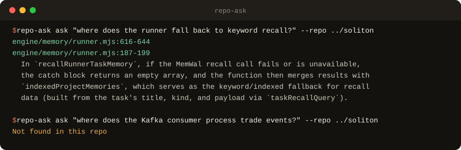
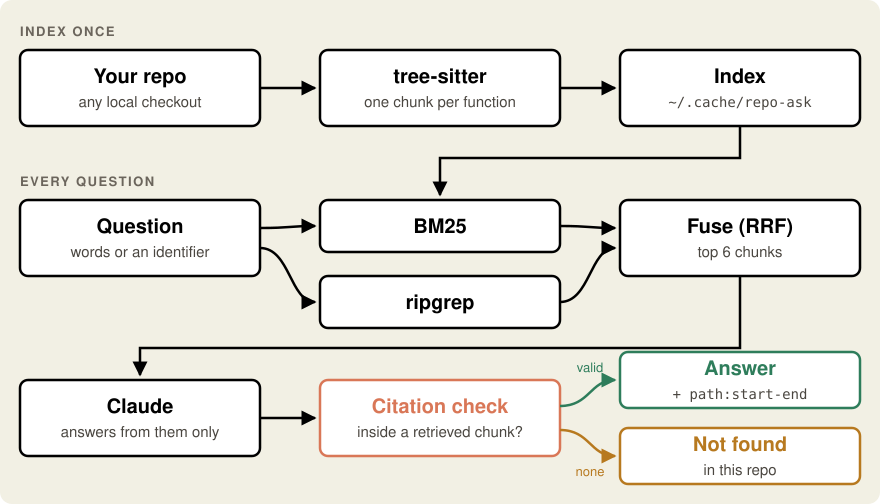

<p align="center">
  
</p>

<h1 align="center">repo-ask</h1>

<p align="center">
  <strong>Ask any codebase a question. Get an answer with <code>file:line</code> citations, or an honest "not found".</strong>
</p>

<p align="center">
  
  
  
  
  <a href="https://github.com/iamsohungrynow/repo-ask/actions/workflows/tests.yml"></a>
  
</p>

<p align="center">
  
  
  
  
</p>

repo-ask is a small command-line tool for finding your way around an unfamiliar repository. It
splits the code into **one chunk per function or class** with tree-sitter, retrieves the most
relevant chunks with **BM25 plus ripgrep**, and asks **Claude** to answer from those chunks only.

Every citation is then checked against what was actually retrieved, so the tool never shows a
reference it did not read. If no citation survives, it prints `Not found in this repo` instead of
guessing. There is no server and no vector database: it is about 700 lines of Python, and the index
is a JSON file in your cache folder, never in your repo.

<p align="center">
  
</p>

<p align="center"><sub>Real output on <a href="https://github.com/iamsohungrynow/Soliton">Soliton</a> at commit <code>9f01a58</code>.</sub></p>

## What works today

**Measured** on Soliton, a TypeScript/JavaScript codebase of about 280 files, on 2026-09-27
([full write-up](docs/evaluation.md)):

| Question set | hit@6 (file) | hit@6 (lines) | Answer accuracy | Abstention | Avg latency |
| --- | --- | --- | --- | --- | --- |
| Held-out, 10 + 2, never tuned on | 9/10 (90%) | 9/10 (90%) | **8/10 (80%)** | **2/2** | 3.12 s |
| Development, 20 + 3 | 18/20 (90%) | 13/20 (65%) | 13/20 (65%) | 3/3 | 3.29 s |

Also checked: **0 rejected citations and 0 errors** across both runs. On the development set,
every question whose retrieved chunks contained the answer was answered correctly, so accuracy is
limited by retrieval, not by the model. The sets are small and were drafted with Claude Code, so
read these numbers as indicative.

- **Cited answers:** each answer starts with the `path:start-end` ranges that support it.
- **No guessing:** a reply with no citation inside the retrieved code becomes `Not found in this repo`.
- **Any local checkout:** only the 6 retrieved chunks are sent to the Claude API.
- **Scripts and editors:** `--json` prints `{found, answer, citations, rejected}`.
- **Measurable:** `repo-ask eval` scores retrieval and answers against your own questions, with or
  without an API key.

Not yet: `.gitignore` support, incremental re-indexing, citations that span two chunks,
embeddings. See the [roadmap](#roadmap).

## Quickstart

You need Python 3.11+, an [Anthropic API key](https://console.anthropic.com/), and optionally
[ripgrep](https://github.com/BurntSushi/ripgrep) (`rg`) on your `PATH`.

```bash
pipx install git+https://github.com/iamsohungrynow/repo-ask
```

```bash
export ANTHROPIC_API_KEY=sk-ant-...
```

Then, from inside any repository:

```bash
repo-ask index .
```

```bash
repo-ask ask "how are database migrations run?"
```

`ask` builds the index on first use if you skip `index`. Re-run `repo-ask index .` after the code
changes.

## Usage

| Command | What it does |
| --- | --- |
| `repo-ask index <repo>` | Chunk the repository and save the index. |
| `repo-ask ask "<question>" [--repo PATH]` | Answer a question about `PATH` (default: the current directory). |
| `repo-ask eval <file.yaml> --repo PATH` | Score retrieval and answers against a question set. |

| Flag | Command | Effect |
| --- | --- | --- |
| `--show-chunks` | `ask` | Print the retrieved chunks to stderr, to see what the answer is based on. |
| `--json` | `ask` | Print `{found, answer, citations, rejected}` as JSON. |
| `--model ID` | `ask`, `eval` | Use a different Claude model for this run. |
| `--retrieval-only` | `eval` | Skip the model: score retrieval only, no API key needed. |
| `--no-bm25`, `--no-rg`, `--bm25-b` | `eval` | Ablations and tuning for the retriever. |
| `--out FILE` | `eval` | Write per-question results as JSON. |

| Environment variable | Default | Purpose |
| --- | --- | --- |
| `ANTHROPIC_API_KEY` | required for `ask` and `eval` | Read from the environment only; never commit it. |
| `REPO_ASK_MODEL` | `claude-sonnet-5` | Claude model used to answer. `--model` overrides it. |
| `REPO_ASK_HOME` | `~/.cache/repo-ask` | Where indexes are stored. Nothing is written into the indexed repo. |

**Languages.** Function- and class-level chunks for **Python, JavaScript, TypeScript (incl.
JSX/TSX), Rust and Java**. Every other text file (Go, C, Markdown, YAML, config, ...) is indexed in
80-line windows, so questions about it still work, with coarser citations. Vendored and generated
files (`node_modules`, `dist`, lockfiles, minified JS, binaries) are skipped. To add a language,
install its `tree-sitter-<lang>` package and add its suffix and definition node types to
[`repo_ask/chunker.py`](repo_ask/chunker.py).

## How it works

<p align="center">
  
</p>

1. **Chunk.** tree-sitter makes one chunk per function or class, with its doc comment attached.
   Definitions over 150 lines are split into their methods, and lines outside any definition become
   windows, so every line belongs to exactly one chunk.
2. **Retrieve.** BM25 handles natural-language questions; the tokenizer splits `camelCase` and
   `snake_case`, so "fallback recall" matches `fallbackRecallFromRecords`. ripgrep handles pasted
   identifiers and ranks definitions above usages. Reciprocal rank fusion merges the two rankings
   without score calibration, and docs are capped at 2 of the 6 slots so code is not crowded out.
3. **Answer.** Claude gets the numbered chunks and must reply in a JSON schema: `answer`,
   `citations`, `found`.
4. **Validate.** A citation survives only if its whole range lies inside one retrieved chunk. No
   survivor means `Not found in this repo`; rejected citations are reported on stderr.

Why each choice was made, and how it would scale to a large monorepo:
[`docs/design.md`](docs/design.md).

## Evaluate it on your own repo

Write a few questions you already know the answers to:

```yaml
questions:
  - id: q1
    question: Where are the model's citations checked against the retrieved chunks?
    expected:
      - {path: repo_ask/answer.py, lines: [145, 154]}   # any overlapping range counts
  - id: u1
    question: Where does the web server check the user's password?
    answerable: false                                   # must reply "Not found in this repo"
```

```bash
repo-ask eval examples/questions.yaml --repo . --retrieval-only
```

[`examples/questions.yaml`](examples/questions.yaml) is a commented starter file that runs on this
repo as-is. Per question, the report shows whether an expected file and an expected line range were
among the 6 retrieved chunks (`hit@6`). Without `--retrieval-only`, it also shows whether the answer
cited the right place and whether unanswerable questions were declined.

## Architecture

```
repo_ask/
  chunker.py    tree-sitter chunks: one per function/class, line windows for everything else
  index.py      build, save and load the index (JSON, under $REPO_ASK_HOME)
  retriever.py  BM25 + ripgrep, reciprocal rank fusion, the docs cap
  answer.py     prompt, JSON schema, one retry, citation validation
  evaluate.py   hit@6, answer and abstention accuracy, latency, the report
  cli.py        repo-ask index | ask | eval
tests/          unit tests with fake API clients: no key needed
eval/           Soliton question sets and per-question results
examples/       a starter question file for your own repo
docs/           design notes, the evaluation write-up, images
```

## Development

```bash
git clone https://github.com/iamsohungrynow/repo-ask && cd repo-ask
python -m venv .venv && source .venv/bin/activate
pip install -e ".[dev]"
pytest
```

CI runs the tests on Python 3.11, 3.12 and 3.13. If you change retrieval, include before and after
`repo-ask eval` numbers in the pull request.

## Roadmap

Ordered by what the evaluation showed matters most.

| Next | Why | Done when |
| --- | --- | --- |
| **Respect `.gitignore`** | ignored files such as `.env` can be indexed | an ignored file in a test repo is never indexed |
| **Down-weight path tokens** | small `api/admin/users/...` handlers outrank `isAdminUser` (q17, q18, h07) | q17 and q18 hit with no held-out loss |
| **Carry module constants into chunks** | a function is retrieved without the constant it reads (h01) | h01 answers "10 minutes" |
| **Citations across adjacent chunks** | a correct answer spanning two chunks is rejected | a two-chunk citation validates |
| **Incremental indexing** | the whole repo is re-chunked after every change | re-indexing touches only changed files |

Known failure modes and the experiments behind them are in
[`docs/evaluation.md`](docs/evaluation.md).

## Licence

MIT ([`LICENSE`](LICENSE)). Built with [Claude Code](https://claude.com/claude-code) as a pair
programmer: Claude Code wrote most of the code, tests and evaluation questions to my specification.
